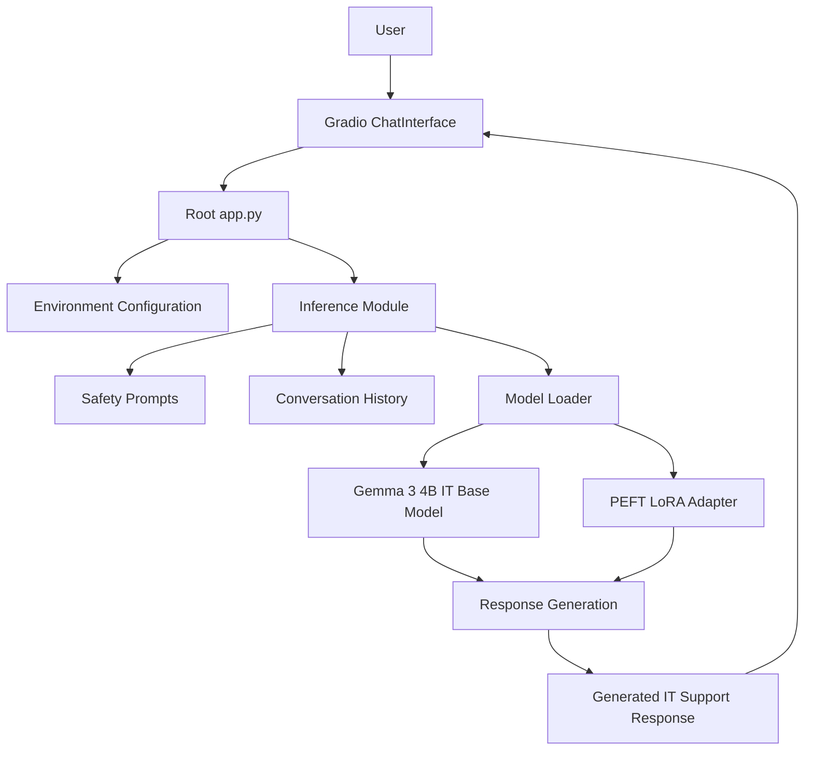

# HelpDeskBuddy AI Assistant — Project Architecture

## 1. Project Overview

HelpDeskBuddy AI Assistant is an AI-powered IT support troubleshooting chatbot built using Gemma 3 4B IT, PEFT/LoRA and Gradio.

The application provides step-by-step guidance for common IT support topics, including Windows troubleshooting, DHCP, DNS, Active Directory and network connectivity.

## 2. High-Level Architecture

## 3. Application Components

### 3.1 User Interface — app.py

- Provides the Gradio ChatInterface.
- Receives user IT support questions.
- Passes messages and conversation history to the inference function.
- Displays generated responses.

### 3.2 Model Loader — src/helpdeskbuddy/model/load_model.py

- Loads the Gemma 3 4B IT base model.
- Loads the PEFT/LoRA adapter.
- Prepares the model and processor for inference.

### 3.3 Inference — src/helpdeskbuddy/inference/chat.py

- Processes user messages.
- Uses conversation history when generating responses.
- Generates IT troubleshooting answers using the loaded model.

### 3.4 Prompts — src/helpdeskbuddy/prompts.py

- Defines instructions for the IT support assistant.
- Helps guide responses toward clear troubleshooting steps.

## 4. Model and Adapter

- Base model: google/gemma-3-4b-it
- Fine-tuning approach: Parameter-Efficient Fine-Tuning (PEFT) with LoRA.
- The trained adapter is stored separately from the base model.

## 5. Dataset

The project includes a synthetic sample dataset at data/sample/helpdesk_synthetic.jsonl.

Each JSONL record contains an ID, category, question, answer and synthetic-data indicator.
The sample dataset is intended for demonstration and testing, not as evidence of model performance.

## 6. Configuration

- Runtime settings are read from environment variables.
- .env.example documents the expected configuration keys.
- The real .env file must remain private and must not be committed to GitHub.

## 7. Request and Response Flow

1. A user submits an IT support question through Gradio.
2. The application passes the question and conversation history to the inference module.
3. The inference module prepares the prompt and input.
4. The loaded Gemma model and LoRA adapter generate a response.
5. Gradio displays the generated response to the user.

## 8. Security Considerations

- Do not include real customer information, passwords, OTPs, PINs or access tokens in datasets.
- Keep .env and authentication tokens out of version control.
- Do not publish model weights or private adapter files unless you have verified their licensing and intended distribution.
- Review generated troubleshooting instructions before applying changes to production systems.

## 9. Limitations

- Responses are generated by an AI model and may be inaccurate.
- The sample synthetic dataset is limited in size and coverage.
- The chatbot does not replace qualified IT administrators or approved organizational procedures.

## 10. Future Improvements

- Expand the reviewed synthetic troubleshooting dataset.
- Add automated evaluation and regression tests.
- Improve response validation and error handling.
- Add deployment documentation and application screenshots.
